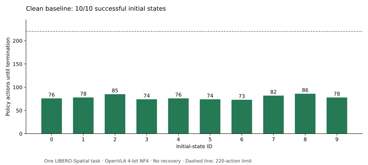

# Clean baseline pilot

**10/10 successful initial states (100%).**

One LIBERO-Spatial bowl-to-plate task, seed 0, initial-state IDs 0–9, ten settling steps, 220-action limit, no recovery.

The simulator ran on the laptop; OpenVLA inference ran in the user-operated Colab runtime. Simulation paused during network requests.

| Initial state | Outcome | Actions | Mean request time | Video |
| --- | --- | ---: | ---: | --- |
| 0 | Success | 76 | 1.64 s | [Watch](state-00/attempt-01/episode.mp4) |
| 1 | Success | 78 | 1.61 s | [Watch](state-01/attempt-01/episode.mp4) |
| 2 | Success | 85 | 1.60 s | [Watch](state-02/attempt-01/episode.mp4) |
| 3 | Success | 74 | 1.62 s | [Watch](state-03/attempt-01/episode.mp4) |
| 4 | Success | 76 | 1.63 s | [Watch](state-04/attempt-01/episode.mp4) |
| 5 | Success | 74 | 1.60 s | [Watch](state-05/attempt-01/episode.mp4) |
| 6 | Success | 73 | 1.67 s | [Watch](state-06/attempt-01/episode.mp4) |
| 7 | Success | 82 | 1.64 s | [Watch](state-07/attempt-01/episode.mp4) |
| 8 | Success | 86 | 1.67 s | [Watch](state-08/attempt-01/episode.mp4) |
| 9 | Success | 78 | 1.66 s | [Watch](state-09/attempt-01/episode.mp4) |

Overall mean request time: 1.63 seconds. Technical-error attempts: 0.

Videos use simulation time and exclude network waiting. Request timings include network/server overhead.

The descriptive Wilson 95% interval is 72.2–100.0% under a binomial model. These are fixed initial states of one task, so this does not establish generalization or robustness.

State 0 reuses the earlier exploratory success; its origin is recorded in manifest.json. This pilot is not an independent confirmatory evaluation. Brightness, occlusion, and physical displacement have not been evaluated here.

Model: `openvla/openvla-7b-finetuned-libero-spatial`, revision `962318cec55ac10993ff0f5f43eda9a270b4c873`, 4bit weights, float16 compute, eager attention.

Raw data: [episodes.csv](episodes.csv), [summary.json](summary.json), [manifest.json](manifest.json).
