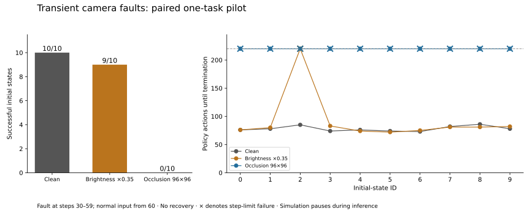
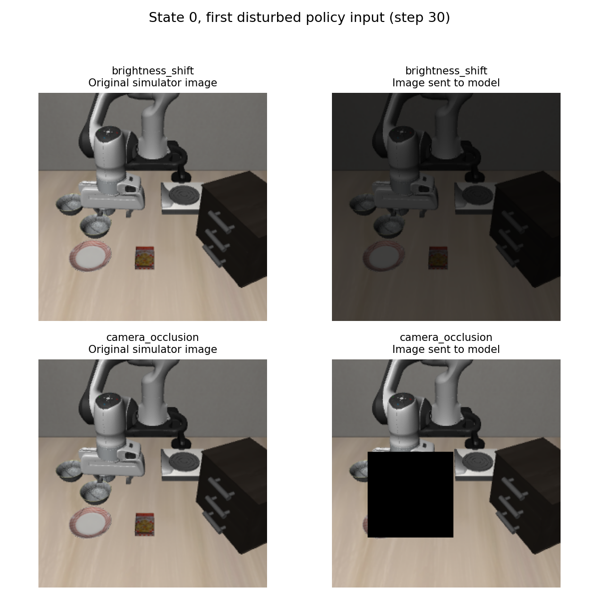
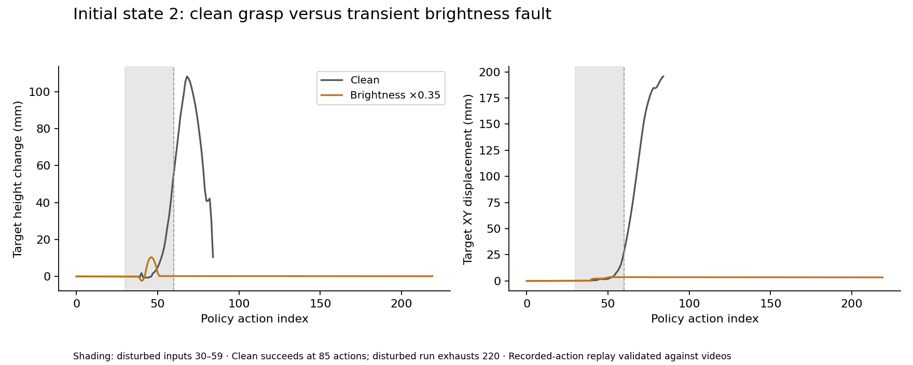

# Transient camera-input robustness pilot

Same bowl-to-plate task and initial-state IDs 0–9. Two camera-input faults at action indices 30–59; normal visibility returns at 60. Recovery is disabled.

| Condition | Successes | Paired loss vs clean | Median extra actions, both successful |
| --- | ---: | ---: | ---: |
| Clean | 10/10 | — | — |
| brightness_shift | 9/10 | 1/10 | 0 |
| camera_occlusion | 0/10 | 10/10 | — |

Extra-action medians include only pairs that succeed in both conditions; failures exhaust the 220-action budget. Technical failures are excluded and listed in the per-condition summaries.

| State | Clean: outcome / actions | Brightness: outcome / actions | Occlusion: outcome / actions |
| --- | --- | --- | --- |
| 0 | Success / 76 | [Success / 76](brightness_shift/state-00/attempt-01/policy-input.mp4) | [Step limit / 220](camera_occlusion/state-00/attempt-01/policy-input.mp4) |
| 1 | Success / 78 | [Success / 80](brightness_shift/state-01/attempt-01/policy-input.mp4) | [Step limit / 220](camera_occlusion/state-01/attempt-01/policy-input.mp4) |
| 2 | Success / 85 | [Step limit / 220](brightness_shift/state-02/attempt-02/policy-input.mp4) | [Step limit / 220](camera_occlusion/state-02/attempt-01/policy-input.mp4) |
| 3 | Success / 74 | [Success / 83](brightness_shift/state-03/attempt-01/policy-input.mp4) | [Step limit / 220](camera_occlusion/state-03/attempt-01/policy-input.mp4) |
| 4 | Success / 76 | [Success / 74](brightness_shift/state-04/attempt-01/policy-input.mp4) | [Step limit / 220](camera_occlusion/state-04/attempt-01/policy-input.mp4) |
| 5 | Success / 74 | [Success / 72](brightness_shift/state-05/attempt-01/policy-input.mp4) | [Step limit / 220](camera_occlusion/state-05/attempt-01/policy-input.mp4) |
| 6 | Success / 73 | [Success / 75](brightness_shift/state-06/attempt-01/policy-input.mp4) | [Step limit / 220](camera_occlusion/state-06/attempt-01/policy-input.mp4) |
| 7 | Success / 82 | [Success / 81](brightness_shift/state-07/attempt-01/policy-input.mp4) | [Step limit / 220](camera_occlusion/state-07/attempt-01/policy-input.mp4) |
| 8 | Success / 86 | [Success / 81](brightness_shift/state-08/attempt-01/policy-input.mp4) | [Step limit / 220](camera_occlusion/state-08/attempt-01/policy-input.mp4) |
| 9 | Success / 78 | [Success / 82](brightness_shift/state-09/attempt-01/policy-input.mp4) | [Step limit / 220](camera_occlusion/state-09/attempt-01/policy-input.mp4) |

Condition links above open the policy-input video. Each neighboring `episode.mp4` shows the unmodified simulator view; `actions.jsonl` records which inputs were disturbed. Videos omit network waits.

## Interpretation limits

These are transient sensor corruptions, not physical lighting or object movement. One task and ten fixed initial states do not establish broad VLA robustness. State 0 was used to choose the occlusion rectangle and the clean state-0 success was imported from an exploratory run. Severity and timing were frozen before disturbed-policy outcomes. No severity was changed to force a failure.

A task failure establishes an observed loss of completion under this protocol; inspect the action/video evidence before attributing a mechanism. A successful disturbed trial may still take longer or follow a different trajectory.

Raw data: [protocol](protocol.json), [paired comparison](comparison.json), [prefix validation](prefix-validation.json), [completed-artifact validation](artifact-validation.json). Model configuration and episode provenance are retained in the manifests.

## Recorded counterexample

[Synchronized comparison video](brightness-state-02-comparison.mp4): clean raw view, brightness-fault raw view, and model input. The clean panel freezes after success; the other panels continue to the fixed step limit. Network waits are excluded.

[Detailed state-2 failure evidence](failure-analysis-brightness-state-02.md). This is recorded episode footage and validated local replay, not live inference.
